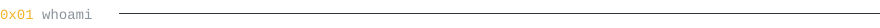

<div align="center">



<br/><br/>


<a href="https://github.com/OverCapi?tab=followers"></a>

</div>

<br/>



<table>
<tr>
<td width="50%" valign="top">

```c
(gdb) p *overcapi
$1 = {
  alias    = "OverCapi",
  school   = "42",
  location = "France",
  langs    = {"fr", "en"},
  building = "kyara-extension",
  learning = "Rust",
  status   = PROMPTING_CLAUDE
}
```

</td>
<td width="50%" valign="top">

```c
(gdb) info registers
rip  0x00000042   <school+0>
rsp  0x7ffd0c0ffee <coffee>
rax  0x0          leaks
rbx  0xdeadbeef   segfaults
rcx  0x1          more emulator
eflags [ ZF CURIOUS ]

(gdb) continue
```

</td>
</tr>
</table>

<br/>


<table>
<tr>
<td width="170"><b><code>.text</code></b><br/><sub>0x00400000 · langs</sub></td>
<td></td>
</tr>
<tr>
<td width="170"><b><code>.data</code></b><br/><sub>0x00600000 · tools</sub></td>
<td>&nbsp;</td>
</tr>
</table>

<p align="center">


</p>

<br/>


<table>
<tr><th>[Nr]</th><th></th><th align="left">Name</th><th align="left">Description</th><th>Stars</th></tr>
<tr>
<td><code>[ 1]</code></td>
<td></td>
<td><a href="https://github.com/OverCapi/kyara-extension"><code>.kyara-extension</code></a></td>
<td>Extension Firefox : valeur des cartes et échanges</td>
<td></td>
</tr>
<tr>
<td><code>[ 2]</code></td>
<td></td>
<td><a href="https://github.com/OverCapi/Random-Block-Placement"><code>.Random-Block-Placement</code></a></td>
<td>Pose de blocs aléatoire, probabilités custom</td>
<td></td>
</tr>
<tr>
<td><code>[ 3]</code></td>
<td></td>
<td><a href="https://github.com/OverCapi/music_app"><code>.music_app</code></a></td>
<td>Simple music app</td>
<td></td>
</tr>
<tr>
<td><code>[ 4]</code></td>
<td></td>
<td><a href="https://github.com/OverCapi/MiniRT"><code>.MiniRT</code></a></td>
<td>Ray tracer 42</td>
<td></td>
</tr>
<tr>
<td><code>[ 5]</code></td>
<td></td>
<td><a href="https://github.com/OverCapi/GameOfLife"><code>.GameOfLife</code></a></td>
<td>Game of Life en C avec SDL</td>
<td></td>
</tr>
</table>

<br/>


<p align="center"></p>

<br/>


```c
00000420  4f 4e 45 50 49 45 43 45  |ONEPIECE|
00000428  69 73 20 72 65 61 6c 21  |is real!|

while (!found(ONE_PIECE))
    sail(GRAND_LINE);   // next stop: Laugh Tale

/* crew:   nakama[] = { claude, gdb, valgrind };  */
/* bounty: 0x00000000 berries (for now)           */
/* hat:    straw, sizeof(dream) > SIZE_MAX        */
```

<p align="center"><sub>[Inferior 1 (process 42) exited normally] · set sail_</sub></p>
